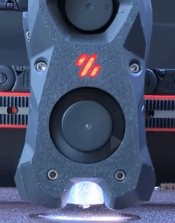

# Voron Tap

> 动图来自 [Maple Leaf Makers](https://github.com/MapleLeafMakers) ，更多信息请参见 https://www.youtube.com/watch?v=mz5qcOZgXhI

Tap 是一个用于 V2 和 Trident 布局的基于喷嘴的 Z 探头。整个工具头移动以触发光学开关。Tap 提供了许多优势：

* 极高的精度 0.4μm (0.0004mm)
* 支持切换任何打印表面
* 通过光学传感器实现的高耐久性（数百万次探针循环）
* 高温可靠性（70C到100C）
* 简化的探针机械结构（无需停靠坞）
* 不需要单独的 Z 限位
* 碰撞保护

## 要求

* 床必须足够稳定以承受 500-800 克的探针力
  * Switchwire, V1.8, Legacy, V0 热床不够坚固
* 安装到 MGN-12H 线轨 X 轴
* 前置安装的喷嘴（Clockwork2, LGX, Galileo）
* 准确度取决于良好的机械条件
* 必须在工具头有 5V 或特殊 24V 传感器 PCB

## 操作指南

完整的组装细节请参阅 [手册](Manual/Assembly_Manual_Tap.pdf)

## 安装后设置

1. 按照 [Tap Klipper 操作指南](config/tap_klipper_instructions.md) 中的建议更新您的 `printer.cfg`
2. 通过抬起工具头进行 Z 轴对零
3. 加热并运行几次 `probe_accuracy samples=100` 以“磨合”您的探针
4. 运行几次 `probe_accuracy` 检查（默认为 10 次探针）

对于结构良好的机器，您可以看到标准偏差在 0.0000 到 0.0008 之间。

## 常见问题

* Tap 是否会损坏我的打印表面？不会，探针温度限制在 150C。Voron 队建议使用喷涂层弹簧钢。使用光滑 PEI 的用户可能会在连续探针同一位置时发现轻微的烧蚀痕迹。
* Tap 是否可以与 Hartk 的 2 件 PCB 一起使用？可以，但需要进行一些修改。请参阅 Discord 置顶信息。
* 可以使用 BOM 中未指定的光学传感器吗？不建议，Voron 团队花费了大量时间验证传感器在 [BOM](BOM.md) 中。
* 可以使用微动开关吗？不建议，但可以参阅 [Unklicky Tap](https://github.com/majarspeed/Unklicky/tree/main/Unklicky_TAP) 了解更多详情。
* 可以使用活动热床安装吗？可以，如果床在 800 克力下足够坚固。
* 这是否增加了很多重量？团队探索了许多设计，并选择了约 50 克作为良好的重量与刚性之间的权衡。
* 如果我的感应探针工作正常，为什么还需要 Tap？Tap 通过消除大部分由于热膨胀、喷嘴和床表面变化引起的微调，提供了更好的用户体验。
* Tap 比 Klicky 更准确吗？是的。

## (加分项) 数据科学

Tap 工程背后有数据科学的支持。如果您想深入了解，请参阅以下资源：

* [Voron:LIVE! Voron Tap 发布会](https://www.youtube.com/watch?v=JLUDLJQXZeU)
* [热环境下的探针准确性](https://github.com/KiloQubit/probe_accuracy)
* [各个角落的重复性](https://github.com/sporkus/probe_accuracy_tests)
